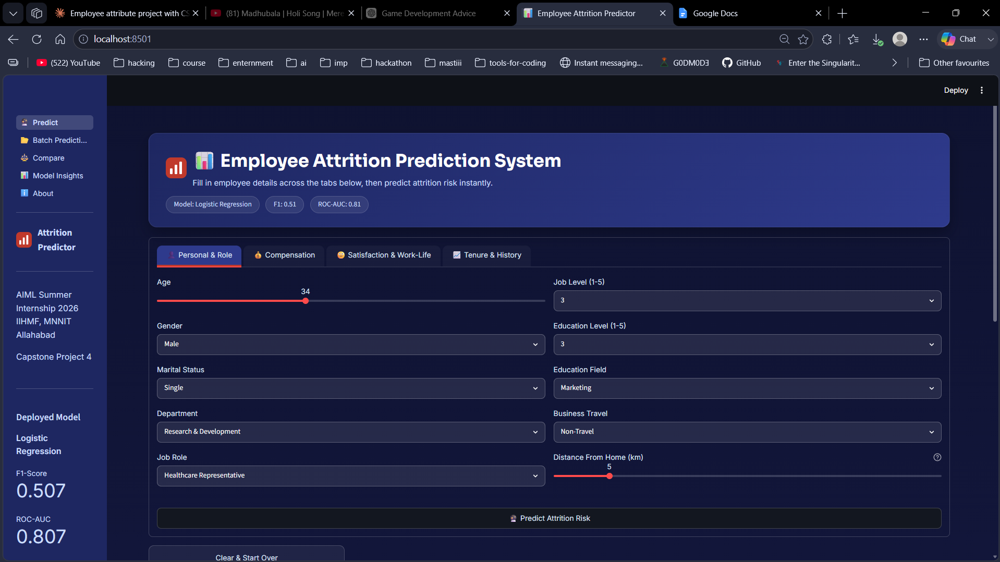
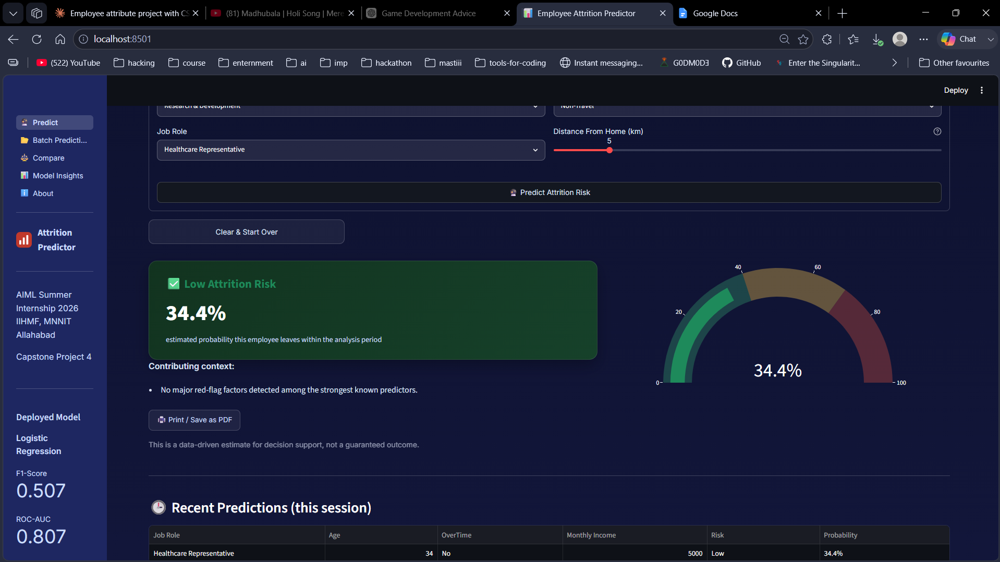
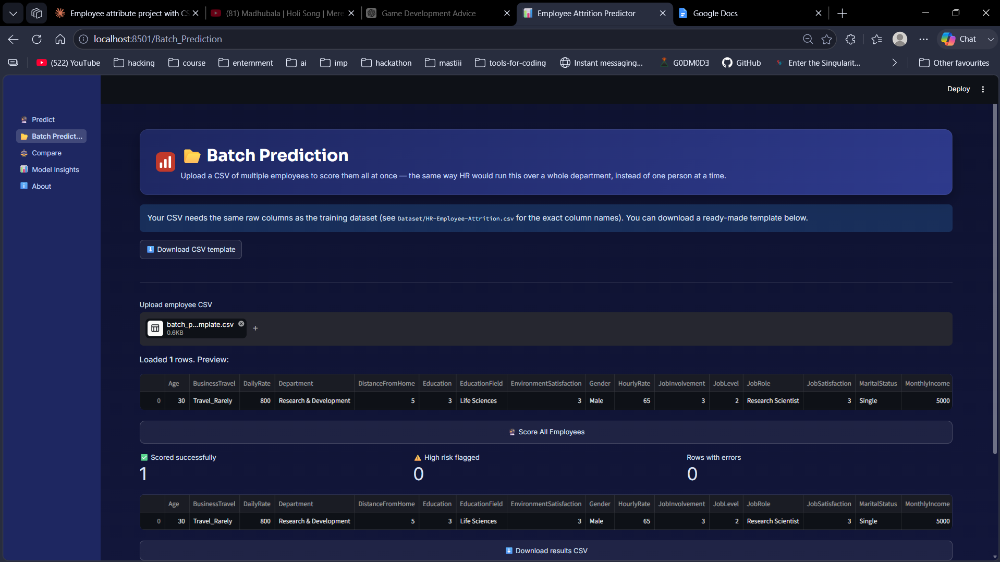
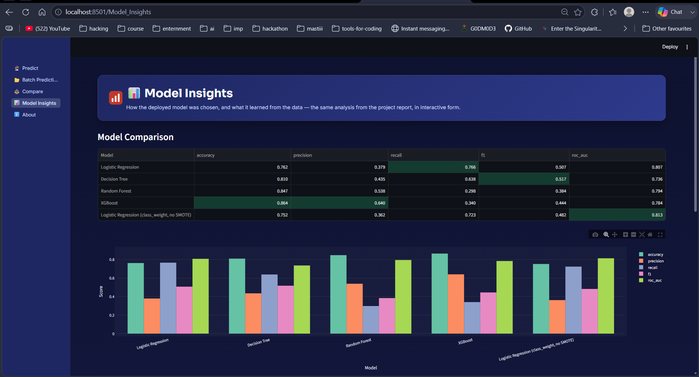

<div align="center">

# 📊 Employee Attrition Prediction System

**Predicting employee attrition risk using classification models, with a full 5-page decision-support web app for HR teams.**


*AIML Summer Internship 2026 — IIHMF, MNNIT Allahabad · Capstone Project 4*

</div>

---

## What is this?

A complete, end-to-end machine learning project that predicts whether an employee is likely to
leave an organization — from raw HR data, through EDA and feature engineering, to a genuinely
usable deployed web app. Not a notebook that sits unused: a 5-page Streamlit application with
single-employee prediction, batch CSV scoring, side-by-side employee comparison, and interactive
model insights.

**The headline finding:** for an HR early-warning tool, the model with the *highest accuracy*
is not the right choice — it misses two-thirds of real leavers. This project explains exactly
why, and picks a model accordingly. See [Model Selection Reasoning](#-why-logistic-regression) below.

## 📸 Screenshots

<table>
<tr>
<td width="50%"></td>
<td width="50%"></td>
</tr>
<tr>
<td align="center"><em>Predict — tabbed input form</em></td>
<td align="center"><em>Predict — live result with risk gauge</em></td>
</tr>
<tr>
<td width="50%"></td>
<td width="50%"></td>
</tr>
<tr>
<td align="center"><em>Batch Prediction — score a whole CSV at once</em></td>
<td align="center"><em>Model Insights — interactive comparison + reasoning</em></td>
</tr>
</table>

## ✨ Features

- **Predict** — single-employee form across 4 tabs, with a probability gauge and rule-based context notes
- **Batch Prediction** — upload a CSV, score an entire department at once, download results
- **Compare** — score two employees side-by-side and see the risk gap between them
- **Model Insights** — interactive model comparison chart, feature importances, and the reasoning behind the deployed model
- **About** — project and team info
- Optional **custom FastAPI + HTML/CSS/JS frontend** (`Advanced_Web_App/`) — same model, fully custom UI, no Streamlit dependency

## 🗂️ Project Structure

```
EmployeeAttritionPrediction/
├── Dataset/                 HR-Employee-Attrition.csv (IBM HR Analytics dataset)
├── Notebook/                Full pipeline notebook (Google Colab, executed end-to-end)
├── Model/                   Trained model, scaler, encoders, metrics
├── Streamlit_App/           Multi-page Streamlit deployment (primary app)
│   ├── app.py                 Router (st.navigation) — run this
│   ├── predict.py              Predict page
│   ├── pages/                  Batch Prediction, Compare, Model Insights, About
│   ├── theme.py                 All colors/text/branding — edit here to restyle
│   ├── fields_config.py         Form fields as data — edit here to add/remove fields
│   ├── model_utils.py           Shared prediction logic (used by Streamlit AND FastAPI)
│   └── EDITING_GUIDE.md         Step-by-step customization recipes
├── Advanced_Web_App/         Optional: FastAPI + custom HTML/CSS/JS deployment
├── Documentation/            Project report, presentation, figures
└── requirements.txt
```

## 🚀 Quick Start

```bash
git clone <this-repo-url>
cd EmployeeAttritionPrediction
pip install -r requirements.txt

cd Streamlit_App
streamlit run app.py
```

Opens the **Predict** page, with Batch Prediction, Compare, Model Insights, and About available
from the sidebar.

<details>
<summary><strong>Optional: run the custom FastAPI + HTML/CSS/JS deployment instead</strong></summary>

```bash
# terminal 1
cd Advanced_Web_App/backend
pip install -r requirements.txt
uvicorn main:app --reload --port 8000

# terminal 2
cd Advanced_Web_App/frontend
python -m http.server 5500
```

Then open `http://localhost:5500`. Full details in `Advanced_Web_App/README.md`.
</details>

<details>
<summary><strong>Re-run the training notebook</strong></summary>

`Notebook/Employee_Attrition_Prediction.ipynb` is built for Google Colab — open it there, run
top to bottom, and upload `HR-Employee-Attrition.csv` when prompted (or mount Google Drive).
Model artifacts are already committed in `Model/`, so this is optional unless you want to
verify the pipeline yourself.
</details>

## 🧠 Pipeline

1. **Preprocessing** — dropped 4 constant columns, verified zero missing values/duplicates, label-encoded 7 categorical fields
2. **EDA** — attrition strongly linked to OverTime, low relative income, frequent travel, low satisfaction, younger age, shorter tenure
3. **Feature Engineering** — added `TenureRatio`, `IncomePerYearExp`, `PromotionGap`, `AvgSatisfaction`
4. **Balancing** — SMOTE on the training set only (post-split, no leakage); validated directly against `class_weight='balanced'`
5. **Models trained** — Logistic Regression, Decision Tree, Random Forest (GridSearchCV), XGBoost
6. **Deployment** — multi-page Streamlit app + optional FastAPI/custom frontend, both sharing identical prediction logic

## 📈 Results

| Model | Accuracy | Precision | Recall | F1 | ROC-AUC |
|---|---|---|---|---|---|
| **Logistic Regression** ✅ | 0.762 | 0.379 | **0.766** | 0.507 | **0.807** |
| Decision Tree | 0.810 | 0.435 | 0.638 | **0.517** | 0.736 |
| Random Forest | 0.847 | 0.538 | 0.298 | 0.384 | 0.794 |
| XGBoost | **0.864** | **0.640** | 0.340 | 0.444 | 0.784 |
| Logistic Regression (class_weight, no SMOTE) | 0.752 | 0.362 | 0.723 | 0.482 | 0.813 |

### 🏆 Why Logistic Regression?

XGBoost has the highest accuracy, but its recall — the share of *actual* leavers it catches —
is only 34%. Decision Tree edges out Logistic Regression on raw F1 (0.517 vs 0.507), but that's
within a 0.02 margin, treated as a practical tie. The tie-break: **ROC-AUC**, a threshold-independent
ranking metric. Logistic Regression's ROC-AUC (0.807) is well ahead of Decision Tree's (0.736) —
making it the more robust choice, not just the model that happened to top one leaderboard.

## 🛠️ Customizing

The Streamlit app is deliberately split into config-as-data files so it can be restyled or
extended without touching the prediction logic:

| Want to... | Edit this file |
|---|---|
| Change colors, fonts, logo, wording | `Streamlit_App/theme.py` |
| Add/remove/reorder a form field | `Streamlit_App/fields_config.py` |
| Change prediction logic (affects both deployments) | `Streamlit_App/model_utils.py` |

Full recipes in `Streamlit_App/EDITING_GUIDE.md`.

## 👥 Team

| Name | Role |
|---|---|
| **Archit Srivastava** | Team Lead |
| Param Gupta | Team Member |
| Adish Tripathi | Team Member |

B.Tech Computer Science & Engineering, United College of Engineering & Research (UCER), Prayagraj

## 📄 Dataset & License

Built on the [IBM HR Analytics Employee Attrition dataset](https://www.kaggle.com/datasets/pavansubhasht/ibm-hr-analytics-attrition-dataset)
(fictional-but-realistic data released by IBM for HR analytics benchmarking). This is an
academic capstone project — see `Documentation/` for the full project report and presentation.
